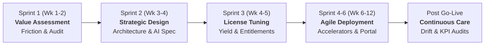

# AnshuAI Enterprise Transformation Program
## Agile Project Plan: Epics, User Stories & Sprint Roadmap

* **Project Name:** AnshuAI Enterprise Transformation & Platform Acceleration
* **Project Key:** `ANSHU`
* **Target Delivery Horizon:** 8 to 12 Weeks (HeadStart Velocity Cadence)
* **Delivery Framework:** Scaled Agile Framework (SAFe) / 2-Week Scrum Sprints
* **Domain & Identity:** [anshuai.in](https://anshuai.in) — *"Intelligence Illuminated"*
* **Executive Oversight:** ServiceNow Certified Technical Architect (CTA) & Enterprise AI Practice Lead

---

## 1. Project Governance & Sprint Cadence

### RACI Governance Structure
* **Accountable:** ServiceNow Certified Technical Architect (CTA)
* **Responsible:** AI/ML Lead, ServiceNow Senior Consultants (CSM/ITSM/FSM), Quality Lead
* **Consulted:** Enterprise Client Stakeholders (CIO, CTO, Clinical/Supply Chain Heads)
* **Informed:** Compliance Officers, Operations Managers, Knowledge Workers

---

## 2. Epics Overview

| Epic ID | Epic Name | Sprint Phase | Primary Focus Area |
| :--- | :--- | :--- | :--- |
| **`EPIC-01`** | **Discovery, Value Assessment & Audit Gaps** | Sprint 1 (Wks 1–2) | Workflow friction discovery, shadow IT analysis & audit logging |
| **`EPIC-02`** | **Target Architecture & Bespoke AI Engineering** | Sprint 2 (Wks 3–4) | ML pipelines, vector databases, LLM agents & Integration Hub |
| **`EPIC-03`** | **ServiceNow Core Industrialization & License Tuning** | Sprint 3 (Wks 4–5) | SLA workflows, entitlement audits, CSM/ITSM/FSM optimization |
| **`EPIC-04`** | **Healthcare HeadStart Accelerator: Clinical Case Mgmt** | Sprints 4–5 (Wks 6–10) | EMR/EHR FHIR API, clinical triage, HIPAA compliance |
| **`EPIC-05`** | **Manufacturing HeadStart Accelerator: Asset Health & FSM** | Sprints 4–5 (Wks 6–10) | IoT telemetry, technician dispatch, product recall tracking |
| **`EPIC-06`** | **FMCG HeadStart Accelerator: Real-Time Inventory & PO** | Sprints 4–5 (Wks 6–10) | Demand forecasting, POS integration, auto replenishment |
| **`EPIC-07`** | **Intelligent AI Automation & Unified Self-Service Portal** | Sprints 5–6 (Wks 8–11) | Virtual agent, NLP document extraction, zero-touch approvals |
| **`EPIC-08`** | **Testing, Governance Verification & Cutover Go-Live** | Sprint 6 (Wks 11–12) | UAT, ISO/SOC2 audits, production cutover & Continuous Care |

---

## 3. Epics & Detailed User Stories

---

### Epic 01: Discovery, Value Assessment & Audit Gaps (`EPIC-01`)
> **Goal:** Quantify workflow friction, catalog spreadsheet/email dependencies, audit existing ServiceNow instance health, and establish baseline operational KPIs.

#### Story `ANSHU-101`: Enterprise Workflow Friction & Silo Assessment
* **Story Points:** 5
* **As a:** Enterprise Process Owner
* **I want to:** Map and measure all manual cross-departmental handoffs, spreadsheet trackers, and email chains
* **So that:** AnshuAI can quantify current operational latency and target the highest-friction bottlenecks.
* **Acceptance Criteria:**
  * **Given** the current operational environment across customer/patient case handling,
  * **When** the AnshuAI discovery team conducts interviews and inspects system logs,
  * **Then** a comprehensive Process Friction Heatmap is produced detailing manual touchpoints, average cycle time, and error rates per team.
* **Technical Tasks:**
  1. Extract ticket resolution logs and re-assignment count distributions.
  2. Inventory shadow IT spreadsheets and manual approval email threads.
  3. Compile baseline cycle-time metrics for resolution SLAs.

#### Story `ANSHU-102`: ServiceNow Instance Health, Schema & Entitlement Audit
* **Story Points:** 8
* **As a:** ServiceNow Certified Technical Architect (CTA)
* **I want to:** Perform an architectural health check on the client's ServiceNow instance (customizations, update sets, table bloat, plugin versions)
* **So that:** We establish a stable baseline for modern Integration Hub and bespoke AI microservice integration.
* **Acceptance Criteria:**
  * **Given** an existing enterprise ServiceNow instance,
  * **When** running instance scan diagnostics and reviewing table architectures,
  * **Then** deliver an Instance Health Scorecard identifying schema defects, outdated scripts, and unutilized licenses.
* **Technical Tasks:**
  1. Run ServiceNow Instance Scan across Security, Performance, and Manageability suites.
  2. Audit CMDB health, data completeness, and orphan records.
  3. Analyze user role assignments vs. active license tiers to identify cost-saving entitlement tuning.

---

### Epic 02: Target Architecture & Bespoke AI Engineering (`EPIC-02`)
> **Goal:** Design the secure target architecture connecting ServiceNow with custom AI microservices, private inference endpoints, and enterprise vector search.

#### Story `ANSHU-201`: Target Integration Hub & REST API Gateway Specification
* **Story Points:** 8
* **As a:** Lead Technical Architect
* **I want to:** Define secure, bi-directional REST / webhook endpoints between ServiceNow Integration Hub and private AI endpoints
* **So that:** ServiceNow can trigger real-time ML inferences and receive structured predictions asynchronously.
* **Acceptance Criteria:**
  * **Given** a case created or updated in ServiceNow,
  * **When** an AI triage or predictive trigger fires,
  * **Then** the payload is dispatched over mTLS with OAuth 2.0 to the AI gateway, returning an inference under 500ms with error fallback.
* **Technical Tasks:**
  1. Configure ServiceNow Outbound REST Message templates and OAuth credentials.
  2. Implement an asynchronous queue handler for long-running batch predictions.
  3. Define OpenAPI 3.0 schema contracts for Case Classification, Anomaly Detection, and Entity Extraction.

#### Story `ANSHU-202`: Private Vector Database & Retrieval-Augmented Generation (RAG) Setup
* **Story Points:** 8
* **As a:** AI/ML Engineer
* **I want to:** Build a dedicated vector store indexed on enterprise standard operating procedures (SOPs), knowledge articles, and compliance manuals
* **So that:** Virtual agents and human operators receive context-grounded, hallucination-free assistance.
* **Acceptance Criteria:**
  * **Given** an inquiry from a customer, technician, or doctor,
  * **When** queried by the virtual agent or case resolver,
  * **Then** top-k semantic chunks are retrieved with citations to approved SOP documents, with cosine similarity > 0.82.
* **Technical Tasks:**
  1. Ingest enterprise SOPs, service manuals, and regulatory PDFs into document chunking pipelines.
  2. Generate embeddings using enterprise-grade models and store in a secure vector database.
  3. Implement strict tenant isolation and role-based access control (RBAC) on retrieval queries.

---

### Epic 03: ServiceNow Core Industrialization & License Tuning (`EPIC-03`)
> **Goal:** Refactor core CSM, ITSM, and FSM modules, optimize license entitlements, enforce rigorous SLAs, and establish immutable audit logging.

#### Story `ANSHU-301`: ServiceNow License Entitlement Audit & Cost Optimization
* **Story Points:** 5
* **As a:** Enterprise Financial / IT Controller
* **I want to:** Rationalize active ServiceNow Fulfiller, Approver, and Requester licenses
* **So that:** The company extracts maximum platform yield without paying for unassigned or duplicate licenses.
* **Acceptance Criteria:**
  * **Given** user activity logs from the last 90 days,
  * **When** comparing logged-in usage against assigned role entitlements,
  * **Then** reallocate inactive fulfiller licenses to read-only or approver tiers, providing documented annual savings.
* **Technical Tasks:**
  1. Generate script to audit user login frequency, role usage, and last activity timestamps.
  2. Classify users into Requester vs. Approver vs. Specialist Fulfiller roles.
  3. Produce a License Optimization Yield Report with actionable reclaim recommendations.

#### Story `ANSHU-302`: Industrialized Workflow Automation & SLA Engine
* **Story Points:** 8
* **As a:** Operations Lead
* **I want to:** Replace manual case handoffs with automated Flow Designer workflows and multi-tier SLA timers
* **So that:** Inquiries and incidents progress without stalling, auto-escalating when breach thresholds approach.
* **Acceptance Criteria:**
  * **Given** a new ticket or case logged in the system,
  * **When** its priority or categorization is set,
  * **Then** the appropriate SLA definition attaches automatically, triggering 50%, 75%, and 90% reminder notifications.
* **Technical Tasks:**
  1. Create modular Flow Designer subflows for assignment routing and approval loops.
  2. Configure SLA definitions with pause conditions for pending-customer states.
  3. Build automated manager escalation notifications via email, Microsoft Teams, and Slack.

---

### Epic 04: Healthcare HeadStart Accelerator (`EPIC-04`)
> **Goal:** Deploy the pre-configured Patient Case Management accelerator, integrating multi-channel intake with clinical EHR/EMR systems while maintaining strict HIPAA compliance.

#### Story `ANSHU-401`: Unified Multi-Channel Patient Case Intake
* **Story Points:** 8
* **As a:** Hospital Patient Care Coordinator
* **I want to:** Aggregate patient inquiries from portal, email, and phone into a single unified patient record
* **So that:** Care teams have 360-degree visibility into patient history and outstanding clinical requests.
* **Acceptance Criteria:**
  * **Given** a patient communication via portal message, phone call, or email,
  * **When** received by the intake gateway,
  * **Then** match the patient using Medical Record Number (MRN) or verified identity, creating or appending to the master case.
* **Technical Tasks:**
  1. Configure ServiceNow CSM Consumer Service Portal with secure authentication.
  2. Implement inbound email parsing rules to sanitize and route clinical inquiries.
  3. Build unified case workspace displaying patient timeline, previous encounters, and active care plans.

#### Story `ANSHU-402`: EMR / EHR Clinical FHIR API Bridge
* **Story Points:** 13
* **As a:** Clinical Informatics Specialist
* **I want to:** Connect ServiceNow securely to Epic, Cerner, or HL7/FHIR endpoints
* **So that:** Clinicians can view relevant lab status, discharge notes, and appointments without switching tabs.
* **Acceptance Criteria:**
  * **Given** an open patient case in ServiceNow,
  * **When** authorized clinical personnel open the case,
  * **Then** real-time patient metadata is retrieved via HL7 FHIR REST API with zero persistent local caching of unencrypted PHI.
* **Technical Tasks:**
  1. Develop secure FHIR connector using SMART on FHIR OAuth 2.0 specifications.
  2. Map FHIR Patient, Encounter, and Observation resources into ServiceNow custom components.
  3. Implement field-level encryption and HIPAA access audit logging for all PHI views.

#### Story `ANSHU-403`: Clinical SLA Triage & Doctor Burnout Reduction Workflows
* **Story Points:** 8
* **As a:** Chief Medical Officer
* **I want to:** Auto-prioritize incoming patient clinical cases using AI urgency triage
* **So that:** Life-critical requests are flagged immediately, saving over 1,000 clinical hours per month.
* **Acceptance Criteria:**
  * **Given** incoming patient symptom notes or refill requests,
  * **When** analyzed by the NLP clinical classifier,
  * **Then** assign severity (Urgent, Moderate, Routine) and route to on-call nurses within 60 seconds.
* **Technical Tasks:**
  1. Train and evaluate clinical NLP entity extractor on symptom taxonomy and prescription refill intents.
  2. Implement red-flag detection (e.g., chest pain, shortness of breath) that bypasses queues directly to on-call paging.
  3. Track and display the "Clinical Hours Saved" dashboard metric in real-time.

---

### Epic 05: Manufacturing HeadStart Accelerator (`EPIC-05`)
> **Goal:** Deploy the Asset Health & Field Service Management (FSM) accelerator, connecting industrial IoT telemetry with automated preventive maintenance and product recall tracking.

#### Story `ANSHU-501`: Industrial IoT Alert Ingestion & Anomaly Detection
* **Story Points:** 8
* **As a:** Plant Operations Manager
* **I want to:** Stream sensor telemetry (vibration, heat, cycle count) into an AI anomaly detector
* **So that:** Abnormal equipment wear is detected days before catastrophic machine failure.
* **Acceptance Criteria:**
  * **Given** high-frequency telemetry from plant floor PLC / SCADA gateways,
  * **When** vibration or thermal readings exceed statistical thresholds,
  * **Then** generate a high-priority Asset Incident in ServiceNow with sensor telemetry attachments.
* **Technical Tasks:**
  1. Build MQTT / Kafka telemetry ingestion bridge to ServiceNow Integration Hub.
  2. Deploy time-series anomaly detection model for predictive vibration analysis.
  3. Auto-populate Asset CI records in ServiceNow CMDB with telemetry history.

#### Story `ANSHU-502`: Dynamic Field Service Technician Dispatch & Spares Requisition
* **Story Points:** 8
* **As a:** Field Service Dispatcher
* **I want to:** Automatically assign the nearest qualified technician with the required spare parts
* **So that:** Preventive maintenance downtime is reduced by at least 25%.
* **Acceptance Criteria:**
  * **Given** a generated IoT maintenance work order,
  * **When** the FSM dynamic scheduling engine runs,
  * **Then** match technician skill certificates, geolocation, and vehicle spare parts inventory, auto-dispatching the task to mobile app.
* **Technical Tasks:**
  1. Configure ServiceNow FSM Dynamic Scheduling and territory routing.
  2. Enable technician mobile app with offline mode and digital repair checklist.
  3. Auto-trigger ERP spare parts reserve and warehouse pick lists.

#### Story `ANSHU-503`: Traceable Batch Product Recall & Audit Workflows
* **Story Points:** 8
* **As a:** Quality & Regulatory Compliance Director
* **I want to:** Trace affected product serial numbers across distributors and supply chains during a safety recall
* **So that:** Recall closures are accelerated by 30–40% with 100% auditable regulatory compliance.
* **Acceptance Criteria:**
  * **Given** a flagged component defect or lot number,
  * **When** the recall workflow is initiated,
  * **Then** identify every downstream assembly and customer shipment, generating auditable recall notices and return logistics tasks.
* **Technical Tasks:**
  1. Design parent-child batch genealogy data models in ServiceNow.
  2. Build automated customer notification and quarantine workflows.
  3. Generate compliance-ready export reports for regulatory bodies (FDA, OSHA, ISO).

---

### Epic 06: FMCG HeadStart Accelerator (`EPIC-06`)
> **Goal:** Deploy the Real-Time Inventory Precision accelerator, linking POS data, warehouse management systems, and predictive demand models to prevent stockouts and cut manual spreadsheets.

#### Story `ANSHU-601`: Multi-Channel POS & Warehouse Inventory Synchronization
* **Story Points:** 8
* **As a:** Supply Chain Director
* **I want to:** Ingest daily POS sales and warehouse stock levels into a unified dashboard
* **So that:** Disparate inventory silos across regional distribution centers are fully visible in real-time.
* **Acceptance Criteria:**
  * **Given** end-of-day sales data from retail partners and distribution hubs,
  * **When** synchronized via automated ETL pipelines,
  * **Then** update real-time SKU levels across all warehouse CIs with zero manual spreadsheet reconciliation.
* **Technical Tasks:**
  1. Build secure REST connectors to SAP / Oracle ERP and third-party WMS.
  2. Implement data deduplication and SKU normalization rules.
  3. Create an executive Inventory Precision Heatmap displaying safety stock levels.

#### Story `ANSHU-602`: Predictive Demand & Stockout Prevention Engine
* **Story Points:** 13
* **As a:** Inventory Procurement Planner
* **I want to:** Predict SKU runout dates using seasonal, historical, and promotional demand models
* **So that:** Stockouts and overstocking are reduced by 20–30%.
* **Acceptance Criteria:**
  * **Given** historical 24-month consumption trends and future promotional calendars,
  * **When** the predictive forecasting model evaluates current stock velocity,
  * **Then** calculate projected runout date and generate replenishment recommendations 14 days before safety stock breach.
* **Technical Tasks:**
  1. Train gradient boosted / transformer time-series forecasting model on historical SKU velocity.
  2. Factor in supplier lead times, minimum order quantities (MOQ), and shipping transit days.
  3. Expose predictions directly on the ServiceNow inventory dashboard with confidence intervals.

#### Story `ANSHU-603`: Automated Replenishment Sprints & Supplier PO Triggers
* **Story Points:** 5
* **As a:** Procurement Specialist
* **I want to:** Automatically create and dispatch purchase orders when stock approaches reorder thresholds
* **So that:** Manual inventory order management effort is reduced by 15–25%.
* **Acceptance Criteria:**
  * **Given** an approved reorder trigger from the demand forecasting engine,
  * **When** order threshold rules are met,
  * **Then** auto-generate PO draft in ERP, route for digital approval if exceeding authorization limits, and dispatch EDI/API order to vendor.
* **Technical Tasks:**
  1. Build automated Flow Designer procurement approval subflows.
  2. Connect to supplier EDI 850 / REST APIs for automated order dispatch.
  3. Track supplier fulfillment confirmation and advance shipping notices (ASN).

---

### Epic 07: Intelligent AI Automation & Unified Self-Service Portal (`EPIC-07`)
> **Goal:** Build the unified self-service portal, virtual agent conversational interface, and document intelligence pipelines.

#### Story `ANSHU-701`: Unified Enterprise Self-Service Portal
* **Story Points:** 8
* **As a:** End Customer or Corporate Employee
* **I want to:** Access a sleek, modern self-service portal with instant case logging, knowledge base search, and live status
* **So that:** I can resolve inquiries without waiting on phone hold or sending manual emails.
* **Acceptance Criteria:**
  * **Given** an authenticated user accessing the portal,
  * **When** searching for a topic or submitting a request,
  * **Then** display relevant verified solutions instantly or route the ticket with real-time SLA tracking.
* **Technical Tasks:**
  1. Build responsive Service Portal theme adhering to AnshuAI brand guidelines.
  2. Implement federated search combining ServiceNow Knowledge Bases and vector RAG articles.
  3. Configure user profile center with notification preferences and ticket status tracking.

#### Story `ANSHU-702`: Generative AI Virtual Agent & Autonomous Case Triage
* **Story Points:** 13
* **As a:** Service Desk Manager
* **I want to:** Deploy an AI Virtual Agent capable of answering complex inquiries and triaging tier-1 requests autonomously
* **So that:** At least 35% of routine requests are resolved without human operator intervention.
* **Acceptance Criteria:**
  * **Given** an incoming chat message,
  * **When** analyzed by the AnshuAI Virtual Agent,
  * **Then** execute safe knowledge retrieval or trigger pre-approved fulfillment subflows, escalating to live human agents when sentiment drops.
* **Technical Tasks:**
  1. Configure ServiceNow Virtual Agent conversations with bespoke LLM grounding.
  2. Implement conversational fallback and human-agent handoff protocols.
  3. Add sentiment analysis to auto-escalate frustrated users to senior specialists.

#### Story `ANSHU-703`: NLP Document Intelligence & Invoice / Form Extraction
* **Story Points:** 8
* **As a:** Back-Office Operations Specialist
* **I want to:** Automatically extract structured fields from scanned PDFs, invoices, and clinical requisition forms
* **So that:** Staff do not spend hours manually transcribing data into ServiceNow tables.
* **Acceptance Criteria:**
  * **Given** an attached PDF or image on a case or PO record,
  * **When** processed by the document intelligence pipeline,
  * **Then** extract target key-value pairs with > 92% field accuracy, highlighting low-confidence fields for human review.
* **Technical Tasks:**
  1. Deploy optical character recognition (OCR) and layout-aware transformer extraction model.
  2. Auto-populate ServiceNow custom table fields from extracted JSON payload.
  3. Build side-by-side human-in-the-loop validation widget in the agent workspace.

---

### Epic 08: Verification, Governance Audit & Cutover Go-Live (`EPIC-08`)
> **Goal:** Conduct end-to-end user acceptance testing, compliance verification (HIPAA/ISO/SOC2), cutover rehearsal, and transition to Continuous Care.

#### Story `ANSHU-801`: End-to-End System Integration & Performance Testing
* **Story Points:** 8
* **As a:** Quality Lead
* **I want to:** Execute automated end-to-end regression and load tests across ServiceNow and AI microservices
* **So that:** We verify zero data dropouts and sub-second response times under peak load before production cutover.
* **Acceptance Criteria:**
  * **Given** simulated peak transaction load (500 concurrent users / 10,000 cases/hr),
  * **When** stress-testing the end-to-end integration pipeline,
  * **Then** error rate remains < 0.05% and p95 API latency remains under 600ms.
* **Technical Tasks:**
  1. Build automated test suites using ServiceNow Automated Test Framework (ATF).
  2. Run Locust / JMeter load test scenarios across Integration Hub endpoints.
  3. Validate database indexing and slow query logs.

#### Story `ANSHU-802`: Security, Regulatory Audit & Compliance Certification
* **Story Points:** 5
* **As a:** Chief Information Security Officer (CISO)
* **I want to:** Audit the end-to-end data encryption, access controls, and immutable audit logs
* **So that:** The deployment achieves zero compliance vulnerabilities under HIPAA, ISO 27001, and SOC 2.
* **Acceptance Criteria:**
  * **Given** sensitive patient or proprietary corporate records,
  * **When** audited by security penetration and compliance verification scans,
  * **Then** confirm 100% TLS 1.3 in-transit, AES-256 at-rest encryption, and complete tamper-evident audit trails.
* **Technical Tasks:**
  1. Conduct static and dynamic application security testing (SAST/DAST).
  2. Verify least-privilege role assignment and multi-factor authentication (MFA) enforcement.
  3. Generate compliance audit documentation package for client legal & risk committees.

#### Story `ANSHU-803`: Production Cutover Rehearsal & Go-Live Execution
* **Story Points:** 8
* **As a:** ServiceNow CTA & Release Manager
* **I want to:** Execute a timed, reversible production cutover plan during an off-peak maintenance window
* **So that:** The new ServiceNow + Bespoke AI solution goes live with zero operational disruption.
* **Acceptance Criteria:**
  * **Given** approved UAT sign-off and validated cutover runbook,
  * **When** the cutover window commences,
  * **Then** deploy update sets, activate AI microservices, migrate master data, and verify production smoke tests within 4 hours.
* **Technical Tasks:**
  1. Prepare detailed cutover runbook with rollback checkpoints and contact roster.
  2. Migrate and validate production update sets and integration credentials.
  3. Conduct live end-to-end smoke tests and issue formal Go-Live broadcast.

#### Story `ANSHU-804`: Continuous Care, AI Model Drift Monitoring & Yield Auditing
* **Story Points:** 5
* **As a:** Enterprise Account Lead
* **I want to:** Monitor model accuracy, data drift, and operational KPI yields post-launch
* **So that:** The enterprise continues to reap measurable business value with regular retraining and license reviews.
* **Acceptance Criteria:**
  * **Given** production inferencing and user feedback loops over 30 days,
  * **When** weekly health telemetry is gathered,
  * **Then** detect any accuracy degradation > 3% and trigger automated retraining pipelines, providing monthly ROI yield summaries.
* **Technical Tasks:**
  1. Set up automated drift detection on input embeddings and model confidence distributions.
  2. Implement user feedback thumbs up/down telemetry on AI virtual agent responses.
  3. Deliver quarterly License Optimization & Operational Yield reviews to enterprise leadership.

---

## 4. Sprint Schedule & Story Point Velocity (8–12 Weeks)

| Sprint | Phase Name | Primary Stories | Total Story Points | Milestone Deliverable |
| :--- | :--- | :--- | :---: | :--- |
| **Sprint 1** (Wks 1–2) | **Value Assessment** | `ANSHU-101`, `ANSHU-102` | **13 pts** | Friction Heatmap & Instance Health Scorecard |
| **Sprint 2** (Wks 3–4) | **Strategic Design** | `ANSHU-201`, `ANSHU-202` | **16 pts** | API Gateway Contracts & Private RAG Architecture |
| **Sprint 3** (Wks 4–5) | **License Tuning** | `ANSHU-301`, `ANSHU-302` | **13 pts** | Entitlement Reclaim & Industrialized SLA Workflows |
| **Sprint 4** (Wks 6–8) | **Accelerator Phase 1** | Vertical Choice: `401/402` or `501/502` or `601/602` | **21 pts** | Core Accelerator Data Pipelines & Intake Bridge |
| **Sprint 5** (Wks 8–10) | **Accelerator Phase 2 & Portal** | Vertical Choice: `403` or `503` or `603` + `701`, `702` | **26 pts** | AI Virtual Agent & Unified Self-Service Portal |
| **Sprint 6** (Wks 10–12) | **Cutover & Go-Live** | `703`, `801`, `802`, `803` | **29 pts** | UAT Sign-Off, Security Clearance & Production Launch |
| **Post-Launch** | **Continuous Care** | `804` | **5 pts** | Drift Monitoring, Retraining & KPI Yield Audits |

---

## 5. Jira / Azure DevOps / ServiceNow SPM Import Template

To import these stories into your project tracking software:
* **Standard Fields:** `Issue Type`, `Key`, `Summary`, `Epic Link`, `Story Points`, `Description`, `Acceptance Criteria`, `Priority`.
* **CSV Export:** The structured format above can be mapped directly to Jira CSV import, Azure DevOps work item sync, or ServiceNow SPM (Agile Development 2.0).
